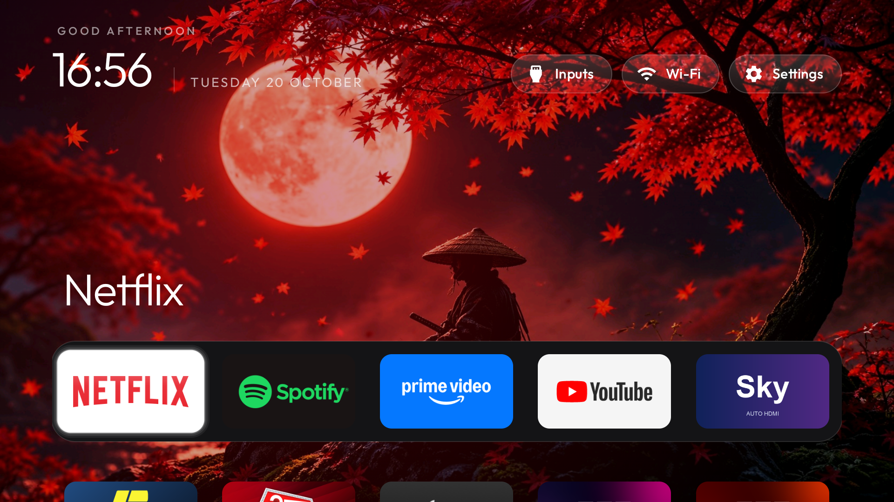
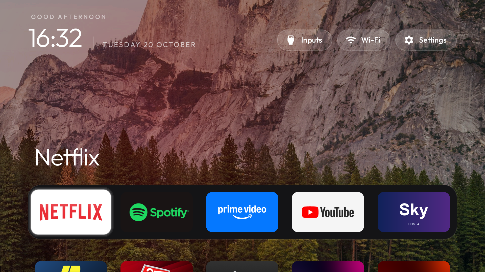
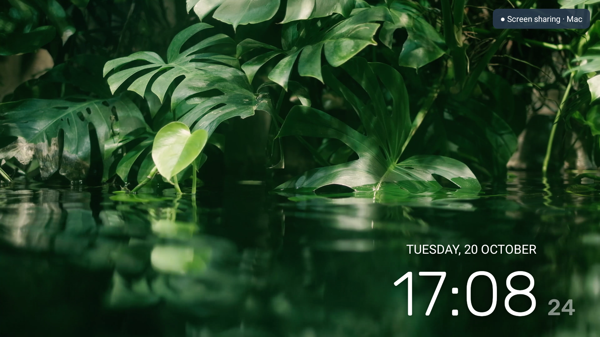

# BRAVIA Home Kit

A clean Sony Android TV home screen, an automatic Sky HDMI shortcut, and Mac controls with optional private remote access.

Built and tested on a **Sony BRAVIA 4K VH22 running Android TV 12**. Other models are untested. This is an independent community project, not affiliated with Sony, Sky, or the app providers.

The home screen comes from **[CleanYourTV by Gathin](https://github.com/Gathin23/cleanyourtv)**. This repository adds the Sony setup helpers, companion apps, and Mac tools. CleanYourTV is included as a Git submodule pinned to the version used for this setup; its code and licence remain upstream.

## Included

- Five-app dock: Netflix, Spotify, Prime Video, YouTube, and Sky.
- Sky shortcut that reads connected HDMI inputs each time: uniquely Sky-labelled input first, otherwise the sole connected port, otherwise a picker. A generic HDMI cable does not identify a Sky box reliably when multiple devices are connected.
- Reversible Home switching and optional removal of Sony promotion/viewing-recognition services. Nothing is uninstalled or factory-reset.
- Private local package/settings snapshots and a journal that restores the exact original enabled states of packages changed by this tool.
- Mac navigation, volume, playback and standby controls.
- Optional scrcpy mirroring with a persistent TV-side badge, a notification, and a TV-side stop control.
- Optional Tailscale access without exposing ADB to the public internet.

Device dumps, network addresses, account identifiers, signing keys and third-party APKs are excluded. Selected home-screen previews and wallpapers are included below; they contain no network or account details.

## Preview





The small sharing badge stays visible on the TV while the Mac viewer is running:



## Wallpapers

Choose the included samurai wallpaper or a nature image from [`wallpapers/`](wallpapers/). To apply one after installing the launcher:

```sh
python3 tvkit.py theme themes/sony-five-apps.json --wallpaper wallpapers/samurai.jpg
```

The sample theme uses a fixed wallpaper. For automatic rotation, see [CleanYourTV’s theme instructions](upstream/cleanyourtv/themes/README.md). Image provenance and licence information are in [`wallpapers/README.md`](wallpapers/README.md).

## Requirements

- Android TV 8+; tested on Sony Android TV 12 only.
- Mac with Python 3.10+, Git, `adb`, and optionally `scrcpy`.
- JDK 17, Android SDK platform 32 and build-tools 34.0.0 for the companion APKs.
- USB/network debugging enabled on your own TV, with this Mac explicitly authorised on the TV.

Install Mac runtime tools using Homebrew:

```sh
brew install android-platform-tools scrcpy
```

If Homebrew reports platform-tools as a cask, use `brew install --cask android-platform-tools` separately. Install JDK/SDK tools from [Android Developers](https://developer.android.com/studio).

## Quick start

```sh
git clone --recurse-submodules https://github.com/azagupta/bravia-home-kit.git
cd bravia-home-kit
python3 tvkit.py configure YOUR_TV_IP:5555
python3 tvkit.py backup
```

Authorise the Mac using the TV's debugging prompt. `.local/` contains your private configuration and backups, and is excluded from Git. Keep it: it contains the restore journal. These are package/settings snapshots, **not firmware or full app-data backups**.

### 1. Build the two companion apps

Set `JAVA_HOME` and `ANDROID_SDK_ROOT` to your own JDK/SDK installation, and put `$JAVA_HOME/bin` on PATH. Ensure the SDK contains `platforms/android-32/android.jar` and `build-tools/34.0.0`.

```sh
scripts/build-app.sh sky-shortcut
scripts/build-app.sh share-indicator
python3 tvkit.py install sky-shortcut/build/sky-shortcut.apk
python3 tvkit.py install share-indicator/build/share-indicator.apk
```

Each app creates its own local debug signing key, ignored by Git. Keep your key to install future builds over your existing app. These development builds are intended for local sideloading. Files in `build/` are ignored; no prebuilt APKs are published here.

### 2. Build and install CleanYourTV

```sh
cd upstream/cleanyourtv/launcher
./gradlew assembleRelease
cd ../../..
python3 tvkit.py install upstream/cleanyourtv/launcher/app/build/outputs/apk/release/app-release.apk
python3 tvkit.py theme themes/sony-five-apps.json --wallpaper /path/to/your-wallpaper.jpg
python3 tvkit.py activate-home
```

CleanYourTV compiles against Android SDK 34. Install that SDK as well, or follow its upstream build instructions. Running `assembleRelease` only builds it; the upstream `build-and-install.sh` is **not** used by these instructions, so this project's journal owns package changes.

On tested Sony firmware, both Google TV Home and the Google TV setup wizard's recovery entry outrank third-party Home. `activate-home` first checks that the new launcher starts, journals original states, then disables the stock launcher and the setup wizard package. It tries to roll back if Home verification fails. Some devices may need their original setup wizard restored for network provisioning: run `restore` first. A lost ADB connection can prevent automatic recovery; retain the backup and reconnect.

### 3. Optional Sony tracking/promotion cleanup

```sh
python3 tvkit.py disable-tracking
```

This only touches installed copies of `tv.samba.ssm`, `tv.samba.ssm.ui`, `com.sonyericsson.idd.agent`, and `com.sony.dtv.promos`. It affects Samba viewing recognition, Sony usage analytics and promotions. Skip this if you need those services. No casting, voice, tuner, HDMI, picture/audio, update or streaming-app package is on this list. This is not a guarantee that all telemetry is removed.

### Restore

```sh
python3 tvkit.py restore
```

Restores package states recorded in the active journal and the original Home activity, on the same identified TV. Added apps and theme files remain installed. Avoid changing the Home setup outside this journal before restoring. An active journal cannot be overwritten with a fresh backup until its package changes have been restored.

## Mac remote and turning the TV off

Double-click `TV Remote.command` or `TV Off.command` in Finder. The remote accepts a key followed by Return. Standby uses Android's **SLEEP** command rather than a power toggle.

```sh
python3 tvkit.py remote
python3 tvkit.py key off
```

This controls Android TV. It does not promise to power up a Sky box or send every Sky remote command. HDMI-CEC interoperability depends on both devices and their settings.

## Screen sharing

On the TV, allow **Screen Sharing** to display over other apps through the TV's Apps/Special app access settings. If that panel is absent on your firmware, the explicitly authorised owner can grant only this app's overlay operation through ADB:

```sh
adb -s YOUR_TV_IP:5555 shell appops set lab.tv.share SYSTEM_ALERT_WINDOW allow
```

Then double-click `TV Screen Share.command`. It waits for the indicator service to start before launching scrcpy. Close the Mac window to stop; on the TV, open **All apps → Screen Sharing → Stop sharing**. The wrapper polls the service/session and closes the stream when the TV requests Stop. The TV badge and foreground notification remain visible during sharing. No recording, audio capture, boot-time mirroring or hidden-viewing mode is configured.

A stream is stopped before its badge is removed during normal shutdown. This is a best-effort companion, not a security boundary against another authorised ADB client. App crashes, network failures and apps that suppress overlays can affect the badge; the wrapper checks for service loss but cannot promise instantaneous enforcement. If the Mac crashes, the badge may remain until the next clean session. A stale `.local/screen-share.lock` after a crash can be removed once no viewer is running.

**Netflix/Prime and other protected video, and HDMI hardware video planes, may appear black. This project does not bypass DRM.** A black picture does not establish that nobody is watching. It was tested with ordinary TV UI and a live 1280×720 stream.

## Away from home: Tailscale

1. Install [Tailscale on macOS](https://tailscale.com/docs/install/mac) and [Android TV](https://tailscale.com/docs/install/android).
2. Sign both into your own private network, approving their normal VPN prompts. Do not select an exit node for this setup.
3. While connected locally, run `python3 tvkit.py vpn-address`. It verifies the VPN endpoint's model and serial against the TV before saving it. The Mac tools then use that address.
4. Test from a phone hotspot before relying on access while away.

Keep your network access rules limited to your own devices. No subnet router or public port forwarding is required. **Do not expose ADB port 5555 to the internet.** Android permits only one active VPN per user: activating Proton VPN on the TV replaces Tailscale and can disconnect remote access. App installation alone does not. Deep standby, reboots, firmware updates and authentication expiry can also affect reachability. Home customisations remain when the Mac or this chat closes; remote viewing only runs while its viewer process is running.

## Validation and scope

The original setup was tested on one Sony BRAVIA VH22/Android 12: Home selection, four streaming-app launches, Sky switching to the connected HDMI port, companion overlay, live mirroring, TV-side sharing stop and a private Tailscale endpoint. Protected video playback and a physically offsite connection were not validated. The generic public helper has automated tests and local build checks; it has not been applied afresh to additional TV models.

```sh
python3 -m unittest discover -s tests -v
```

An optional GitHub Actions template is in `ci/github-actions.yml`. To enable hosted checks, copy it to `.github/workflows/check.yml` using a GitHub login authorised to manage workflows. It runs the Python checks and builds both Android companions.

See [ATTRIBUTION.md](ATTRIBUTION.md) for the upstream dependencies and [LICENSE](LICENSE) for this project's MIT licence. For Android versions newer than the tested firmware, review foreground-service, target-SDK and sideloading requirements before use.
